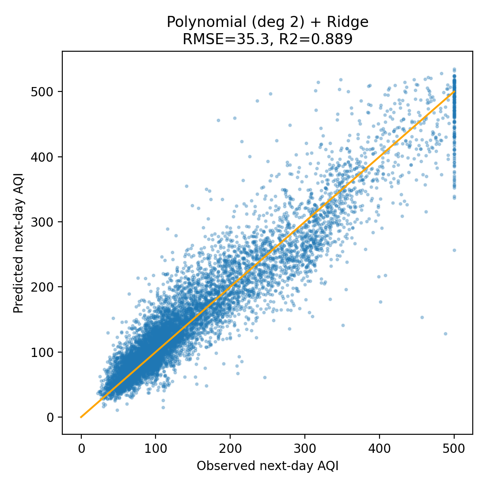

# Next-Day AQI Forecasting and Health-Alert Classification for Indian Cities

ML course assignment 
B.Sc. (H) Computer Science,
Sem V,
University of Delhi.
SDG 3 (Good Health and Well-being) and SDG 11 (Sustainable Cities and Communities).

## Project Overview

The Air Quality Index (AQI) is normally published only after the day has passed, so people get no warning of a bad-air day. This project uses machine learning on public CPCB data for 26 Indian cities to predict tomorrow's AQI and to warn whether tomorrow will be "Poor" or worse (AQI > 200). Every model is compared with a simple baseline (persistence: tomorrow = today) to check that machine learning actually adds value.

## Problem

- Regression: forecast tomorrow's AQI from today's pollutant concentrations.
- Classification: will tomorrow be "Poor" or worse (AQI > 200)?

## Key Terms

- AQI: Air Quality Index, a number from 0 to 500 (higher means worse air). Above 200 is "Poor" or worse.
- Persistence baseline: predicts that tomorrow's AQI equals today's. A model is only useful if it beats this.
- Chronological split: training uses earlier years and testing uses later years, so the model never sees the future.
- Forward-chaining CV (TimeSeriesSplit): cross-validation where each fold trains on the past and validates on the next period.
- Winsorising: clipping extreme values at the 1st and 99th percentiles instead of deleting them.
- Recall: share of real alert days that the model caught. It matters most here because a missed alert costs more than a false alarm.

## Data

Kaggle "Air Quality Data in India (2015-2020)", file city_day.csv (https://www.kaggle.com/datasets/rohanrao/air-quality-data-in-india), compiled from CPCB. Licence: CC0. Put the file at data/city_day.csv.
29,531 rows, 26 cities, 1 Jan 2015 to 1 Jul 2020.

## Technologies Used

Python, Pandas, NumPy, Scikit-learn, Matplotlib, Seaborn

## How to run

```
python -m venv venv
venv\Scripts\activate          # Windows  (Mac/Linux: source venv/bin/activate)
pip install -r requirements.txt
python 01_eda.py               # figures 1-3, missing-value table
python 02_regression.py        # 8 regressors, tables 2-3, lockdown, per-city (a few minutes)
python 03_classification.py    # 7 classifiers, table 4, ROC curves
python 04_pca_analysis.py      # PCA figure and table 5
python 05_summary.py           # prints all results in one summary
```

All random seeds are 42. Outputs go to figures/ and results/.

## Method (short)

- Chronological split: train 2015-2018, test Jan 2019 - Feb 2020, lockdown (25 Mar - 30 Jun 2020) held out as a stress test.
- Preprocessing inside one sklearn Pipeline, fitted on training data only: median imputation, winsorising at 1st/99th percentile, standardisation, one-hot city.
- Hyper-parameters by GridSearchCV with 5-fold forward-chaining TimeSeriesSplit.
- Baseline: persistence (tomorrow = today).
- Features: 11 pollutant concentrations, today's AQI, yesterday's AQI, 3-day mean AQI, month (sin/cos) and city. Xylene was dropped (61.3% missing).

## Folder structure

```
utils.py              shared data loading, split, pipeline
01_eda.py ... 05_summary.py
data/                 city_day.csv
figures/              all plots used in the report
results/              all tables (CSV)
```

## Results

All results are on the held-out test set (1 Jan 2019 - 29 Feb 2020). Training: 2015-2018 (13,041 samples). Test: 8,374 samples. COVID lockdown (25 Mar - 30 Jun 2020, 2,369 samples) is a separate stress test. The full tables for all models are in results/ and results/summary.txt.

### Next-day AQI regression

| Model | MAE | RMSE | R2 |
|---|---|---|---|
| Persistence baseline | 25.59 | 42.43 | 0.839 |
| Linear regression (OLS) | 24.55 | 36.90 | 0.879 |
| Lasso | 24.39 | 37.75 | 0.873 |
| Decision tree | 23.33 | 36.39 | 0.882 |
| SVR (RBF) | 23.69 | 34.96 | 0.891 |

SVR gave the lowest test RMSE, 17.6% below persistence. The strongest lasso predictors were today's AQI, PM2.5, the 3-day mean AQI and CO.

### Health alert classification (next-day AQI > 200)

| Model | Accuracy | Precision | Recall | F1 | AUC |
|---|---|---|---|---|---|
| Persistence baseline | 0.922 | 0.832 | 0.834 | 0.833 | - |
| Logistic regression | 0.938 | 0.873 | 0.860 | 0.866 | 0.981 |
| Decision tree | 0.927 | 0.791 | 0.931 | 0.855 | 0.974 |
| SVM (RBF) | 0.938 | 0.870 | 0.863 | 0.866 | 0.979 |
| MLP (64-32) | 0.937 | 0.865 | 0.865 | 0.865 | 0.981 |

Logistic regression and SVM tied for the best F1. The decision tree had the highest recall (0.931). For logistic regression, 273 of 1,944 real alert days were missed (14.0%).

### Robustness checks

- COVID lockdown: SVR RMSE 25.18 vs persistence 21.11, so the model was worse than persistence when emissions changed suddenly (distribution shift).
- Per-city: SVR beat persistence in 20 of 25 cities. It was worse in Kolkata, Coimbatore, Shillong, Kochi and Ernakulam, mostly cities with little or no training data.
- PCA (95% variance) did not improve results (OLS RMSE 36.90 -> 40.07).

## Visualizations

### Mean AQI by month (winter is the worst season)


### Observed vs predicted next-day AQI (SVR)


### ROC curves of the classifiers


## Key Findings

- Simple models are enough: even linear regression beats the persistence baseline, and SVR is only slightly better.
- Today's AQI and particulate matter (PM2.5, PM10) carry most of the information.
- Models need monitoring: they fail when conditions change suddenly (lockdown) or for cities with no training data.

## Limitations

- No weather data (wind, temperature, humidity), which affects day-to-day pollution.
- City-level averages hide differences between monitoring stations.
- Data ends in July 2020.
- The final regression model was picked on test RMSE; cross-validation preferred a different model (Polynomial + Ridge), so differences between the better models are small.

## Future Improvements

- Add weather data as features.
- Use station-level data and data beyond 2020.
- Test online re-training to handle sudden changes.

## Author

Ananya Jaiswal
B.Sc. (H) Computer Science, University of Delhi