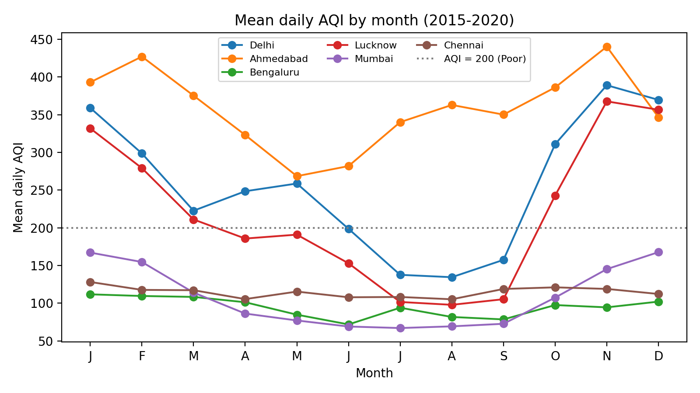
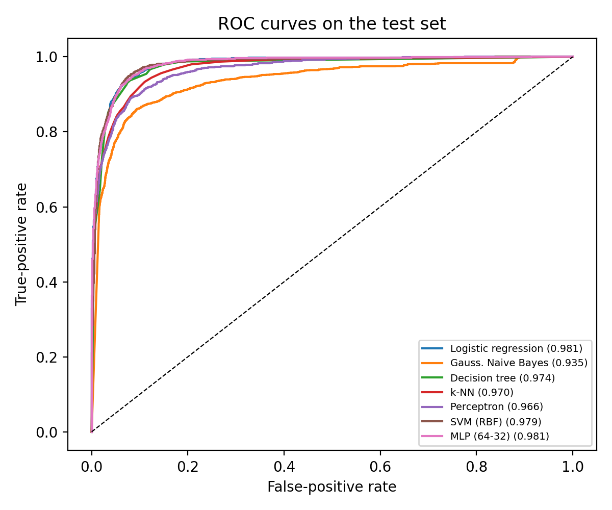
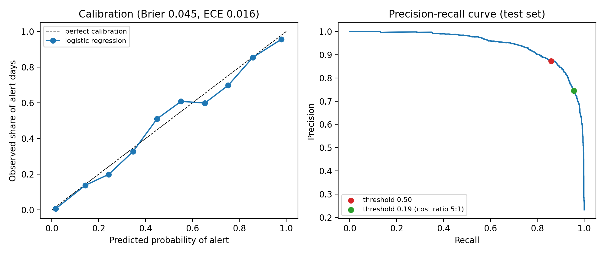
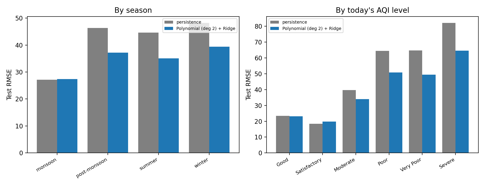

# Next-Day AQI Forecasting and Health-Alert Classification for Indian Cities

ML course assignment
B.Sc. (H) Computer Science, Sem V, University of Delhi.
SDG 3 (Good Health and Well-being) and SDG 11 (Sustainable Cities and Communities).

## Project Overview

The Air Quality Index (AQI) is normally published only after the day has passed, so people get no warning of a bad-air day. This project uses machine learning on public CPCB data for 26 Indian cities to predict tomorrow's AQI and to warn whether tomorrow will be "Poor" or worse (AQI > 200). Every model is compared with a simple baseline (persistence: tomorrow = today) to check that machine learning actually adds value.

## Problem

- Regression: forecast tomorrow's AQI from today's pollutant concentrations.
- Classification: will tomorrow be "Poor" or worse (AQI > 200)?

## Key Terms

- AQI: Air Quality Index, a number from 0 to 500 (higher means worse air). Above 200 is "Poor" or worse.
- Persistence baseline: predicts that tomorrow's AQI equals today's. A model is only useful if it beats this.
- Chronological split: training uses earlier years and testing uses later years, so the model never sees the future.
- Forward-chaining CV (TimeSeriesSplit): cross-validation where each fold trains on the past and validates on the next period.
- Winsorising: clipping extreme values at the 1st and 99th percentiles instead of deleting them.
- Recall: share of real alert days that the model caught. It matters most here because a missed alert costs more than a false alarm.
- Block bootstrap: resampling whole calendar weeks to get confidence intervals that respect correlation between neighbouring days.
- Calibration: whether predicted probabilities match reality (e.g. days given a 70% alert probability really are alert days about 70% of the time). Measured with the Brier score.
- Decision threshold: the probability above which the model issues an alert. Lowering it catches more real alerts but raises more false alarms.

## Data

Kaggle "Air Quality Data in India (2015-2020)", file city_day.csv (https://www.kaggle.com/datasets/rohanrao/air-quality-data-in-india), compiled from CPCB. Licence: CC0. Put the file at data/city_day.csv.
29,531 rows, 26 cities, 1 Jan 2015 to 1 Jul 2020.

## Technologies Used

Python, Pandas, NumPy, Scikit-learn, Matplotlib, Seaborn

## How to run

```
python -m venv venv
venv\Scripts\activate          # Windows  (Mac/Linux: source venv/bin/activate)
pip install -r requirements.txt
python 01_eda.py               # figures 1-3, missing-value table
python 02_regression.py        # 8 regressors, tables 2-3, lockdown, per-city (a few minutes)
python 03_classification.py    # 7 classifiers, table 4, ROC curves
python 04_pca_analysis.py      # PCA figure and table 5
python 06_uncertainty.py       # CV mean +/- sd and bootstrap confidence intervals
python 07_alert_analysis.py    # calibration, thresholds, cost of missed alerts
python 08_error_analysis.py    # error by season, pollution level and city
python 09_extension.py         # gradient boosting and extra features
python 05_summary.py           # prints all results in one summary
```
All random seeds are 42. 
Outputs go to figures/ and results/.

## Method (short)

- Chronological split: train 2015-2018, test Jan 2019 - Feb 2020, lockdown (25 Mar - 30 Jun 2020) held out as a stress test.
- Preprocessing inside one sklearn Pipeline, fitted on training data only: median imputation, winsorising at 1st/99th percentile, standardisation, one-hot city.
- Hyper-parameters by GridSearchCV with 5-fold forward-chaining TimeSeriesSplit.
- The final regressor (by CV-RMSE) and final classifier (by CV-F1) are selected by cross-validation only; the test set is used once, for reporting.
- Baseline: persistence (tomorrow = today).
- Features: 11 pollutant concentrations, today's AQI, yesterday's AQI, 3-day mean AQI, month (sin/cos) and city. Xylene was dropped (61.3% missing).
- Uncertainty: CV mean +/- sd across folds, and 95% block-bootstrap intervals (resampling calendar weeks) for the test RMSE.
- Alert threshold: chosen on a validation slice of the training years (never on the test set), by minimising (cost ratio x missed alerts + false alarms). The cost ratio is an assumption.
- Extension: gradient boosting and extra features (previous-day PM2.5 and PM10, 7-day mean AQI, season), compared by CV and by bootstrap intervals for the RMSE difference.

## Folder structure

```
utils.py              shared data loading, split, pipeline
01_eda.py ... 09_extension.py
data/                 city_day.csv
figures/              all plots used in the report
results/              all tables (CSV)
```

## Results

All results are on the held-out test set (1 Jan 2019 - 29 Feb 2020). Training: 2015-2018 (13,041 samples). Test: 8,374 samples. COVID lockdown (25 Mar - 30 Jun 2020, 2,369 samples) is a separate stress test. The full tables for all models are in results/ and results/summary.txt.

### Next-day AQI regression

| Model | MAE | RMSE | R2 | CV-RMSE (mean +/- sd) |
|---|---|---|---|---|
| Persistence baseline | 25.59 | 42.43 | 0.839 | - |
| Linear regression (OLS) | 24.55 | 36.90 | 0.879 | 43.04 +/- 6.13 |
| Lasso | 24.39 | 37.75 | 0.873 | 42.26 +/- 4.62 |
| Decision tree | 23.33 | 36.39 | 0.882 | 44.15 +/- 3.97 |
| SVR (RBF) | 23.69 | 34.96 | 0.891 | 44.40 +/- 5.05 |
| **Polynomial (deg 2) + Ridge (final, chosen by CV)** | 24.37 | 35.26 | 0.889 | 41.76 +/- 5.21 |

The final model was chosen by lowest CV-RMSE (Polynomial + Ridge). On the test set, used once, it reaches RMSE 35.26, which is 16.9% below persistence. SVR has a slightly lower test RMSE (34.96) but was not selected because it ranked worse in CV. The fold sd (about 4 to 6) is larger than the CV gaps between the top models, so those models should be treated as roughly equivalent. The strongest lasso predictors were today's AQI, PM2.5, the 3-day mean AQI and CO.

### Uncertainty (95% block-bootstrap intervals, test set)

| Quantity | Estimate | 95% interval |
|---|---|---|
| RMSE, final model | 35.26 | 33.45 - 36.99 |
| RMSE, persistence | 42.43 | 39.46 - 45.34 |
| RMSE reduction vs persistence | 16.9% | 14.0% - 19.4% |

The improvement over persistence is clearly above zero. These intervals reflect test-sample variability only, not uncertainty from training or model selection.

### Health alert classification (next-day AQI > 200)

| Model | Accuracy | Precision | Recall | F1 | AUC |
|---|---|---|---|---|---|
| Persistence baseline | 0.922 | 0.832 | 0.834 | 0.833 | - |
| Logistic regression (final, chosen by CV-F1) | 0.938 | 0.873 | 0.860 | 0.866 | 0.981 |
| Decision tree | 0.927 | 0.791 | 0.931 | 0.855 | 0.974 |
| SVM (RBF) | 0.938 | 0.870 | 0.863 | 0.866 | 0.979 |
| MLP (64-32) | 0.937 | 0.865 | 0.865 | 0.865 | 0.981 |

Logistic regression had the best CV-F1 (0.884 +/- 0.026) and tied with SVM for the best test F1. The decision tree had the highest recall (0.931). For logistic regression at the default threshold, 273 of 1,944 real alert days were missed (14.0%).

### Alert calibration and threshold choice

The logistic regression probabilities are well calibrated on the test set (Brier score 0.045, expected calibration error 0.016). The threshold was chosen on a validation slice of the training years by minimising (r x missed alerts + false alarms), where r is how many false alarms one missed alert is worth (an assumption).

| Threshold | Chosen by | Precision | Recall | Missed alerts | False alarms |
|---|---|---|---|---|---|
| 0.50 | default | 0.873 | 0.860 | 273 (14.0%) | 243 |
| 0.44 | r = 1 | 0.858 | 0.885 | 223 | 285 |
| 0.38 | r = 2 | 0.837 | 0.906 | 182 | 343 |
| 0.19 | r = 5 | 0.745 | 0.956 | 86 (4.4%) | 636 |
| 0.13 | r = 10 | 0.699 | 0.973 | 52 | 816 |

Lowering the threshold from 0.50 to 0.19 catches 187 more real alert days at the price of 393 more false alarms (about 2.1 false alarms per extra alert caught). Which point to use is a public-health decision: missed alerts expose children, the elderly and people with asthma to bad air without warning.

### Error analysis (final regressor vs persistence, test RMSE)

| Group | Model | Persistence |
|---|---|---|
| Winter (Dec-Feb) | 39.36 | 48.21 |
| Summer (Mar-May) | 35.09 | 44.66 |
| Monsoon (Jun-Sep) | 27.37 | 27.13 |
| Post-monsoon (Oct-Nov) | 37.18 | 46.32 |
| Today's AQI: Good | 23.20 | 23.38 |
| Satisfactory | 19.74 | 18.46 |
| Moderate | 33.98 | 39.64 |
| Poor | 50.77 | 64.50 |
| Very Poor | 49.49 | 64.76 |
| Severe | 64.63 | 82.13 |

The model clearly beats persistence in winter, summer, post-monsoon and at higher pollution levels, and only ties it in the monsoon, when AQI is low and stable. Of the 7 cities with no training data, 4 are worse than persistence; the other two cities where the model loses (Kolkata and Amaravati) had little training data (205 and 313 days). The more volatile a city's AQI, the more the model gains (Spearman correlation -0.78 between persistence RMSE and the model's change versus persistence), so very stable cities such as Coimbatore and Ernakulam are hard to beat. Details are in results/tableA2_city_diagnostics.csv.

### Extension: gradient boosting and extra features

| Variant | CV-RMSE | Test RMSE | Test R2 | RMSE gain vs A (95% CI) |
|---|---|---|---|---|
| A: Poly + Ridge, base features | 41.75 +/- 5.21 | 35.26 | 0.889 | - |
| B: Gradient boosting, base features | 40.03 +/- 4.93 | 35.49 | 0.888 | -0.23 (-1.08, +0.60) |
| C: Poly + Ridge, extended features | 41.97 +/- 5.44 | 34.05 | 0.897 | +1.21 (+0.94, +1.47) |
| D: Gradient boosting, extended features | 39.11 +/- 4.80 | 33.28 | 0.901 | +1.98 (+1.25, +2.67) |

Extra features (previous-day PM2.5 and PM10, 7-day mean AQI, season) give a reliable improvement; gradient boosting on the base features gives no reliable improvement. Variant D has the best CV-RMSE and the lowest test RMSE. The robustness analyses in this README were run on variant A.

### Robustness checks

- COVID lockdown: final model RMSE 23.66 vs persistence 21.11, so the model was worse than persistence when emissions changed suddenly (distribution shift).
- Per-city: the final model beat persistence in 19 of 25 cities. It was worse in Kolkata, Amaravati, Coimbatore, Shillong, Kochi and Ernakulam, mostly cities with little or no training data.
- PCA (95% variance) did not improve results (OLS RMSE 36.90 -> 40.07).

## Visualizations

### Mean AQI by month (winter is the worst season)


### Observed vs predicted next-day AQI (final model)


### ROC curves of the classifiers


### Calibration and precision-recall of the alert model


### Error by season and pollution level


## Key Findings

- Simple models are enough: linear regression is within about 5% of the best test RMSE, and every learned model beats the persistence baseline.
- Today's AQI and particulate matter (PM2.5, PM10) carry most of the information, and extra lagged and seasonal features add a reliable further gain.
- Alert probabilities are well calibrated, and the threshold is a trade-off between missed alerts and false alarms.
- Models need monitoring: they fail when conditions change suddenly (lockdown) or for cities with little or no training data.

## Limitations

- No weather data (wind, temperature, humidity), which affects day-to-day pollution.
- City-level averages hide differences between monitoring stations.
- Data ends in July 2020.
- Cross-validation cannot clearly separate the top regressors (differences are within one fold sd), and the bootstrap intervals cover test-sample variability only.
- The cost ratio behind the alert threshold is an assumption, not an estimate from health data.
- The lockdown, per-city, season and pollution-level analyses use the base-feature Polynomial + Ridge model, not the extension model.

## Future Improvements

- Add weather data as features.
- Use station-level data and data beyond 2020.
- Test online re-training to handle sudden changes.
- Apply gradient boosting and the extra features to the alert classifier.

## Author

Ananya Jaiswal
B.Sc. (H) Computer Science, University of Delhi